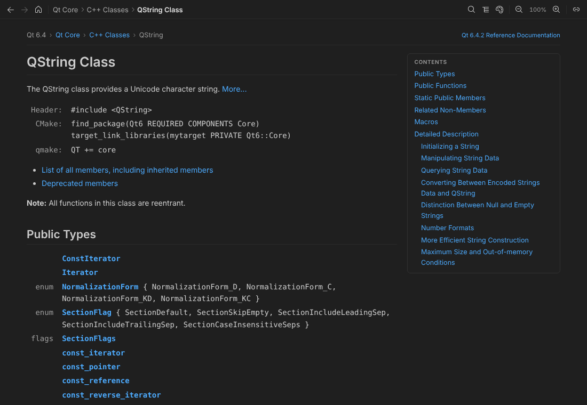
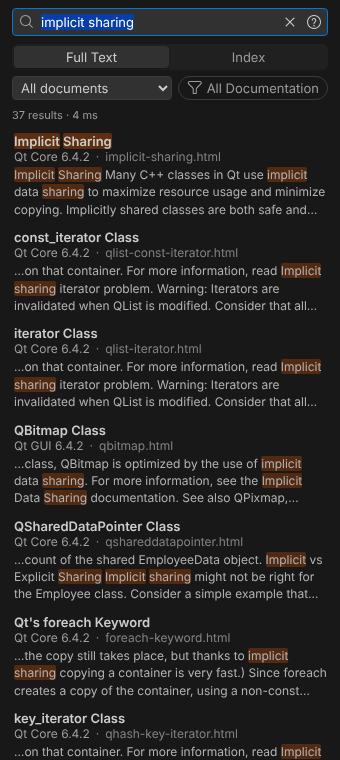

# QCH Documentation Reader

Browse, search and filter **Qt Compressed Help** (`.qch`) documentation without leaving VS Code — the Qt reference, Qt Creator plugins, or any Doxygen/QDoc project that ships `.qch` files.



## Features

- **Point it at a folder.** Every `.qch` file in the configured folders (and, optionally, the workspace) is loaded. Double-click a `.qch` file in the Explorer to open it directly.
- **Contents tree** of every document, with "Reveal current page" sync.
- **Index search** — Qt Assistant's keyword index (classes, functions, properties, topics) with exact/prefix/substring ranking and `*`/`?` wildcards.
- **Full-text search** across all pages, ranked with BM25 and boosted by titles and keywords:

  | Query                       | Meaning                        |
  | --------------------------- | ------------------------------ |
  | `signal slot`               | pages containing both words    |
  | `"implicitly shared"`       | exact phrase                   |
  | `regul*`                    | words starting with "regul"    |
  | `thread -signal`, `NOT x`   | exclusion                      |
  | `utf8 OR latin1`, `( … )`   | alternatives and grouping      |
  | `title:model`               | word in the page title         |
  | `doc:qtcore`, `in:"Qt GUI"` | restrict to matching documents |

  `QString::arg` and `setText` work too: identifiers are indexed whole and split into their camelCase/snake_case parts.

- **Filters** — the filters declared by the documentation (`<customFilter>`), Qt's modern component/version filters, and your own filters (`QCH: Create Filter…`). The active filter applies to the contents, index and search, and is shown in the status bar.
- **Cross-links** — links between modules (`../qtgui/qwindow.html`, `qthelp://…`) are resolved like Qt Assistant does: by virtual folder across all loaded documents. Ctrl/Cmd+click or middle-click opens a link in a new tab, Alt+click to the side.
- **A real documentation browser** — back/forward history (Alt+←/→, mouse buttons), breadcrumbs, find in page (Ctrl/Cmd+F, match case, whole word), search terms highlighted on the page, zoom, link preview, "search the docs for this selection", and panels restored after a reload.
- **Two page styles** — _themed_ (a clean reading style that follows your color theme, including syntax colors for code) or _original_ (the stylesheets shipped in the `.qch`).
- **Editor integration** — `Shift+F1` opens the documentation of the symbol under the cursor (context help), hovers show a summary for symbols found in the keyword index, and `qthelp://` URLs in any file become clickable.



## Getting started

1. Run **QCH: Add Documentation Folder…** (or click the button in the QCH Documentation view) and pick the folder containing your `.qch` files — for a Qt installation that is typically `~/Qt/Docs/Qt-6.x.y` or `/usr/share/qt6/doc`.
2. Open the **QCH Documentation** view in the activity bar. Browse the contents or use the **Search** view (`Index` tab for keywords, `Full Text` for everything).
3. Press `Shift+F1` on a symbol in C++/QML/Python code to jump to its documentation, or `Ctrl+Alt+F1` (`Cmd+Alt+F1`) to look up any keyword.

The full-text index is built in background worker threads the first time a document is loaded and cached afterwards, so later sessions start instantly.

## Commands

| Command                                 | Default key                    |
| --------------------------------------- | ------------------------------ |
| QCH: Look Up Symbol in Documentation    | `Shift+F1`                     |
| QCH: Go to Keyword in Documentation…    | `Ctrl+Alt+F1`                  |
| QCH: Search Documentation               |                                |
| QCH: Select Filter… / Create Filter…    |                                |
| QCH: Add / Remove Documentation Folder… |                                |
| QCH: Open qthelp:// URL…                |                                |
| QCH: Reload Documentation               |                                |
| QCH: Rebuild Full-Text Search Index     |                                |
| QCH Viewer: Back / Forward              | `Alt+←` / `Alt+→`              |
| QCH Viewer: Find in Page                | `Ctrl+F`                       |
| QCH Viewer: Zoom In / Out / Reset       | `Ctrl+=` / `Ctrl+-` / `Ctrl+0` |

Links of the form `vscode://lucio-f.qch-reader/open?url=qthelp://…`, `…/keyword?name=QString` and `…/search?q=…` open the reader from outside VS Code.

## Settings

| Setting                                       | Default                        | Description                                                                 |
| --------------------------------------------- | ------------------------------ | --------------------------------------------------------------------------- |
| `qchReader.folders`                           | `[]`                           | Folders or `.qch` files to load (`~`, `${userHome}`, `${workspaceFolder}`). |
| `qchReader.recursive`                         | `true`                         | Scan subfolders.                                                            |
| `qchReader.includeWorkspaceFiles`             | `true`                         | Also load `.qch` files found in the workspace.                              |
| `qchReader.appearance`                        | `themed`                       | `themed` or `original` page style.                                          |
| `qchReader.openPagesIn`                       | `active`                       | Open the viewer in the active editor group or beside it.                    |
| `qchReader.fullTextSearch.enabled`            | `true`                         | Build full-text indexes.                                                    |
| `qchReader.fullTextSearch.indexOnStartup`     | `true`                         | Index in the background right after loading.                                |
| `qchReader.search.maxResults`                 | `300`                          | Maximum results per search.                                                 |
| `qchReader.filters`                           | `[]`                           | Your filters: `{ "name", "components", "versions", "attributes" }`.         |
| `qchReader.hover.enabled` / `hover.languages` | `true` / `cpp, c, qml, python` | Documentation hovers.                                                       |
| `qchReader.documentLinks.enabled`             | `true`                         | Clickable `qthelp://` links.                                                |

## How it works

A `.qch` file is a SQLite database whose pages are stored `qCompress`-ed and whose table of contents is a `QDataStream` blob. The extension reads it with its **own read-only SQLite implementation written in TypeScript** (b-trees, overflow pages, record format, all text encodings), so there are no native modules or WebAssembly to ship, and nothing depends on the Electron/Node build VS Code uses.

```
src/
  core/        VS Code-independent logic (unit tested)
    sqlite/    read-only SQLite reader
    qch/       .qch model: files, keywords, contents, filter attributes, qUncompress, QDataStream
    library/   multi-document library, qthelp:// URL resolution, filters
    html/      tolerant HTML tokenizer, page rewriting (links, inlined images/CSS), text extraction
    search/    tokenizer, query parser, inverted index (binary, cached), BM25 search, keyword index
  ui/          extension host: services, tree view, search view, viewer, editor integration
  webview/     viewer and search view front-ends (plain DOM + TypeScript, no framework)
  workers/     worker thread that builds full-text indexes
```

Pages are rendered inside a shadow root with a strict content security policy: documentation scripts never run, images and stylesheets are inlined from the `.qch`, and links are routed through the extension.

## Development

```sh
npm install
npm run build        # bundle with esbuild (npm run watch for incremental builds)
npm run check        # typecheck + lint + format check + tests
npm run package      # produce a .vsix
```

Press `F5` in VS Code to launch an Extension Development Host.

- **Static validation:** TypeScript in its strictest configuration (`strict`, `exactOptionalPropertyTypes`, `noUncheckedIndexedAccess`, …) for both the extension and the webviews, ESLint with `typescript-eslint`'s `strict-type-checked` and `stylistic-type-checked` rule sets (zero warnings allowed), and Prettier.
- **Tests:** Vitest. The SQLite reader is checked row-for-row against Node's built-in `node:sqlite` on the fixtures and on generated databases (page sizes from 512 B to 64 KiB, UTF-8/UTF-16 encodings, every integer width, overflow chains).
- **Fixtures:** `test/fixtures/*.qch` are produced by Qt's own `qhelpgenerator` from the projects defined in `scripts/build-fixtures.mjs` (`node scripts/build-fixtures.mjs` regenerates them).
- **Real documentation:** set `QCH_TEST_DIRS` to directories of `.qch` files (e.g. `QCH_TEST_DIRS=/usr/share/qt6/doc npm test`) to also verify every table against SQLite, render pages, resolve cross-links and run searches on them.

## License

[MIT](LICENSE)
